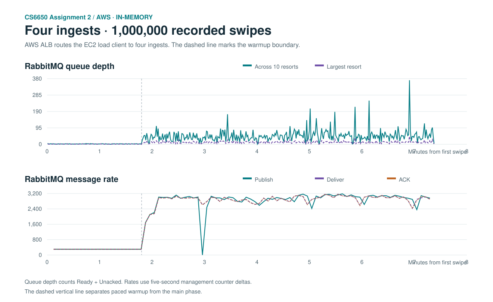
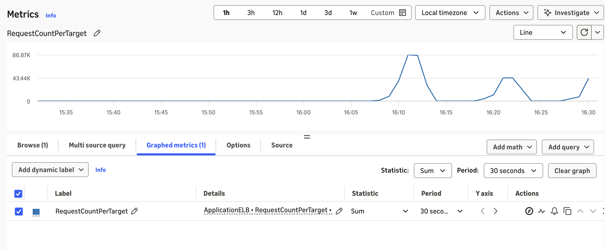
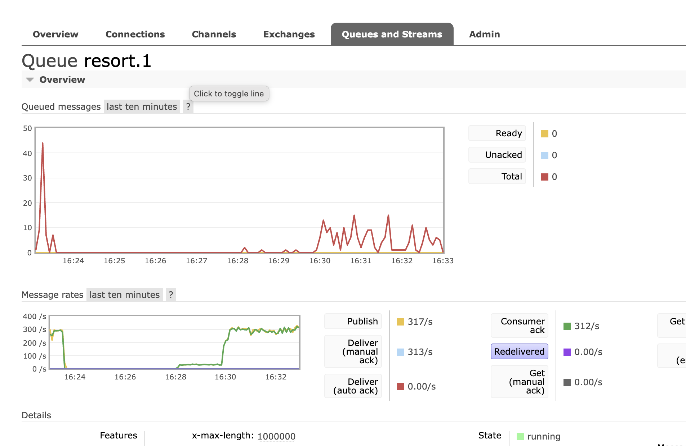
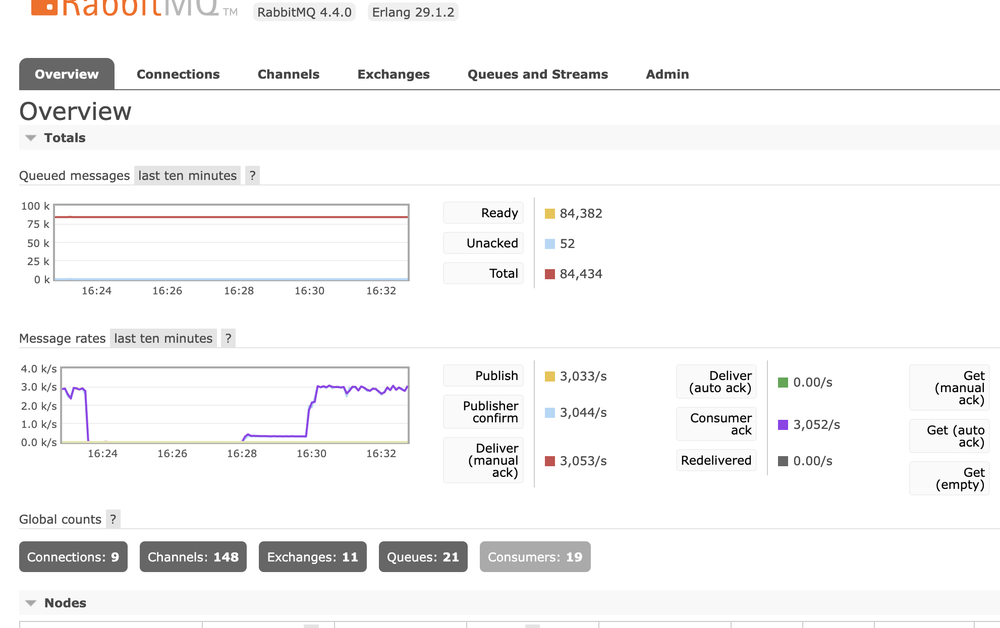

# Assignment 2 — AWS four-ingest 1M unpaced stress test

November 13, 2026 · 16:28:05 PST to 16:35:28 PST

The A2 load client ran on the RabbitMQ EC2 host and sent HTTP and WebSocket traffic through the AWS ALB to four ingests. The Consumer ran in memory mode. The client sent 32,000 warmup swipes paced at 300/s, then 968,000 swipes with `TARGET_RPS=0` and 128 client threads. The Consumer used 40 workers. The one-second guard checked Ready + Unacked for each resort queue.

## Same four-ingest path at 500K and 1M

| Metric | 500K | 1M |
|---|---:|---:|
| Main-phase HTTP throughput (requests/s) | 2,805.71 | 2,883.09 |
| Total HTTP runtime including warmup (s) | 274.01 | 442.82 |
| HTTP P95 (ms) | 69.91 | 68.31 |
| HTTP P99 (ms) | 92.08 | 90.44 |
| Consumer mean lag (ms) | 16.28 | 17.25 |
| Consumer P99 lag (ms) | 60 | 74 |
| Consumer maximum lag (ms) | 339 | 204 |
| Swipes with Consumer lag ≥ 100 ms | 611 | 2,631 |
| Peak single-resort Ready + Unacked | 54 | 46 |
| Peak aggregate Ready + Unacked | 430 | 371 |
| Mean aggregate Ready + Unacked | 26.05 | 37.69 |
| Successful HTTP 201 | 500,000 | 1,000,000 |
| New dead letters | 0 | 0 |

Main-phase throughput changed by +2.8%. Across the full run, 2,631 of 1,000,000 swipes (0.263%) reached 100 ms lag or more. P99 was 74 ms. The sampled aggregate peak was 371. The busiest resort reached a depth of 46, below the per-resort guard threshold of 1,000. The business-queue figures exclude the preexisting dead letters.

## Delivery and ALB distribution

The client recorded 1,000,000 successful swipes, 0 failed swipes and 0 logged retry triggers. The Consumer aggregated 1,000,000 unique swipes with 0 duplicates. RabbitMQ management counters recorded 1,000,000 publishes, 1,000,000 deliveries and 1,000,000 ACKs. All ten business queues drained.

| Ingest | Successful POSTs | Share |
|---|---:|---:|
| ingest-1 | 249,998 | 25.000% |
| ingest-2 | 250,000 | 25.000% |
| ingest-3 | 249,999 | 25.000% |
| ingest-4 | 250,003 | 25.000% |

All four ingests returned the same ordered leaderboard and version for each of the ten resorts. The client received 1,944 distinct updates, matching the final version total. The WebSocket check reached all four ALB targets on fresh connections. All 12 replays of the original AWSALB cookie returned to the same target. [Affinity evidence](alb-affinity.json)

## EC2 resources

| Role | Main-phase CPU busy | Peak service memory (MiB) | Host RX (MiB) | Host TX (MiB) |
|---|---:|---:|---:|---:|
| ingest-1 | 10.7% | 237.8 | 155.2 | 180.7 |
| ingest-2 | 10.7% | 225.5 | 155.2 | 180.8 |
| ingest-3 | 14.3% | 199.7 | 155.5 | 180.5 |
| ingest-4 | 12.5% | 198.8 | 155.5 | 180.6 |
| consumer | 18.2% | 597.0 | 398.4 | 33.7 |
| rabbitmq | 98.9% | 197.3 | 1201.9 | 927.5 |

RabbitMQ and the load client share a host. Its main-phase CPU utilization suggests a shared capacity constraint. The measurements cover the whole host. After testing, the original SQLite service was restored and the original JAR hash and database event count were verified.

[Client output](client-output.txt) · [Structured metrics](summary.json) · [Comparison CSV](comparison.csv) · [Queue series](depth-series.csv) · [Broker rate series](message-rate-series.csv) · [Four-ingest 500K baseline](../aws-four-500k-memory-unpaced-20261113/README.md)

## Console evidence

CloudWatch RequestCountPerTarget during the run at 16:32 PST. The rightmost rise is the start of the 1M run. The console shows Sum with a 30-second period.

RabbitMQ resort.1 at 16:33 PST. The 1M run begins around 16:28 on the chart.

RabbitMQ Overview at 16:32 PST. The 84,382 ready messages are from the historical dead-letter queue.
