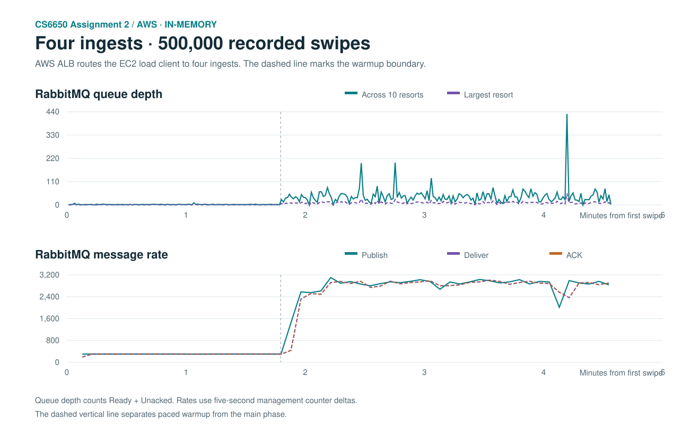
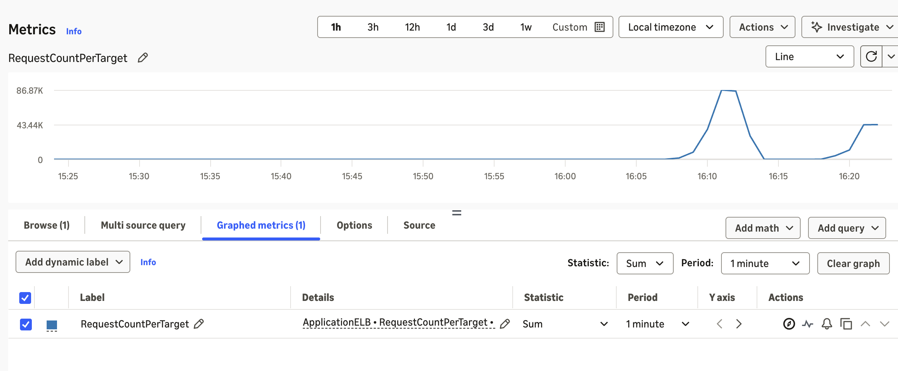
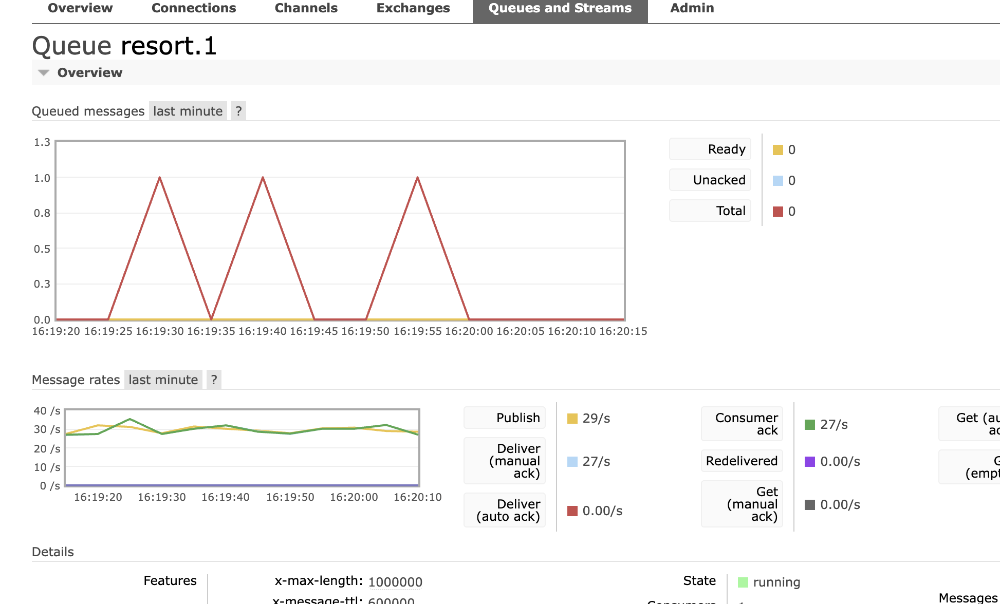

# Assignment 2 — AWS four-ingest 500K unpaced stress test

November 13, 2026 · 16:18:58 PST to 16:23:32 PST

The client and queue guard ran on the RabbitMQ EC2 host. The ALB routed traffic to four EC2 ingests. The Consumer used in-memory aggregation. All three 500K tests used 32,000 warmup requests paced at 300/s, followed by 468,000 unpaced requests with 128 client threads and 40 Consumer workers.

## Comparison

| Metric | One ingest, VPC direct | Two ingests, ALB | Four ingests, ALB |
|---|---:|---:|---:|
| Main HTTP throughput (requests/s) | 2,478.33 | 2,824.75 | 2,805.71 |
| Total HTTP runtime (seconds, including warmup) | 295.83 | 272.90 | 274.01 |
| HTTP P99 (ms) | 115.42 | 90.74 | 92.08 |
| Consumer mean lag (ms) | 33.88 | 19.14 | 16.28 |
| Consumer P99 lag (ms) | 102 | 70 | 60 |
| Consumer maximum lag (ms) | 687 | 380 | 339 |
| Lag ≥ 100 ms (swipes) | 5,534 | 1,015 | 611 |
| Peak single-resort Ready + Unacked | 32 | 35 | 54 |
| Peak aggregate Ready + Unacked | 169 | 255 | 430 |
| Successful HTTP 201 and unique swipes aggregated | 500,000 | 500,000 | 500,000 |
| New dead letters | 0 | 0 | 0 |

The four-ingest main phase delivered -0.7% throughput versus two ingests through the same ALB, and +13.2% versus the direct single-ingest run. Both ALB runs shared a broker and load client host. Its CPU was 99.2% busy with two ingests and 99.4% with four during the main phase. This suggests shared host CPU as a possible constraint. Individual broker and client CPU are not isolated by these host counters.

## Delivery and distribution

The client recorded 500,000 HTTP 201s, with 0 failures and 0 logged retry triggers. RabbitMQ recorded 500,000 publishes, 500,000 deliveries and 500,000 ACKs. All ten business queues drained. The Consumer recorded 0 duplicates and 611 swipes at or above 100 ms across 500,000 lag samples.

| Backend | HTTP 201 POSTs | Share |
|---|---:|---:|
| ingest-1 | 125,000 | 25.00% |
| ingest-2 | 124,999 | 25.00% |
| ingest-3 | 125,001 | 25.00% |
| ingest-4 | 125,000 | 25.00% |

All four ingests returned identical final leaderboard versions and ordered standings for the ten resorts. The load client received 1,646 distinct updates, matching the final version sum. Fresh WebSocket connections reached all four ALB targets, and all 12 cookie replays returned to the original target. [ALB affinity probe](alb-affinity.json)

| EC2 role | Main-phase CPU busy | Peak service memory (MiB) | Host RX (MiB) | Host TX (MiB) |
|---|---:|---:|---:|---:|
| ingest-1 | 10.79% | 228.1 | 78.3 | 90.6 |
| ingest-2 | 10.44% | 215.6 | 78.2 | 90.6 |
| ingest-3 | 15.64% | 191.5 | 78.4 | 90.5 |
| ingest-4 | 13.23% | 190.6 | 78.4 | 90.4 |
| consumer | 16.50% | 380.6 | 199.8 | 18.6 |
| rabbitmq | 99.43% | 200.4 | 601.9 | 467.7 |

The runtime, queue metrics and host resources are from this run. The original SQLite service was restored and its original JAR hash and processed event count were verified.

[Client output](client-output.txt) · [Structured metrics](summary.json) · [Comparison CSV](comparison.csv) · [Queue series](depth-series.csv) · [Message rate series](message-rate-series.csv) · [Single-ingest baseline](../aws-single-500k-memory-unpaced-20261113/README.md) · [Two-ingest baseline](../aws-two-500k-memory-unpaced-20261113/README.md)

## Console evidence

CloudWatch displays the target-group `RequestCountPerTarget` metric with `Sum` and a one-minute period. The earlier peak around 86.9K belongs to the two-ingest run. The rightmost points show about 43.4K requests per healthy target per minute during the four-ingest run. The exact split above comes from the four ingest access logs.

The RabbitMQ `resort.1` capture at 16:20:17 PST shows paced warmup at about 30 messages/s. The reported queue peaks use one-second samples from all ten resort queues, including the unpaced main phase.

The 16:21:25 PST broker Overview shows about 2,885 publishes/s and 2,899 consumer ACKs/s during the unpaced main phase. Its 84,382 Ready messages belong to the historical dead-letter queue. [RabbitMQ Overview](rabbitmq-overview.png)
