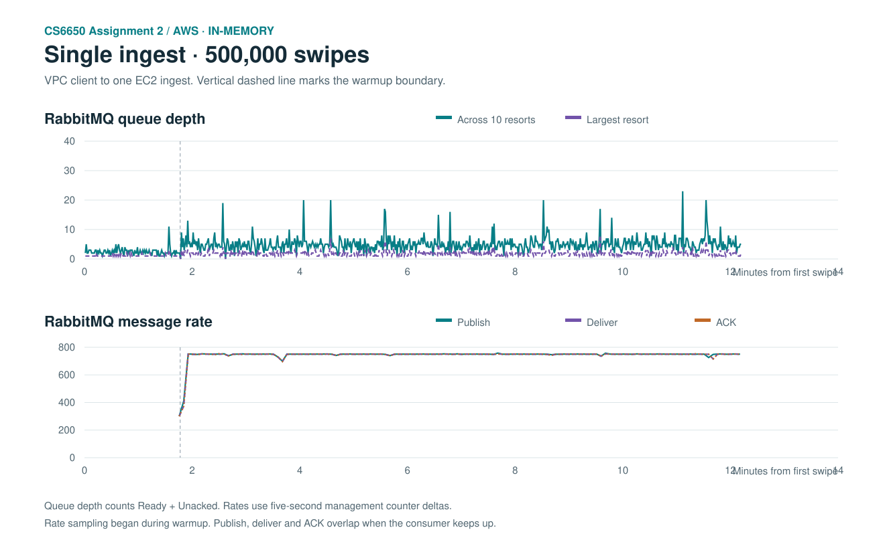
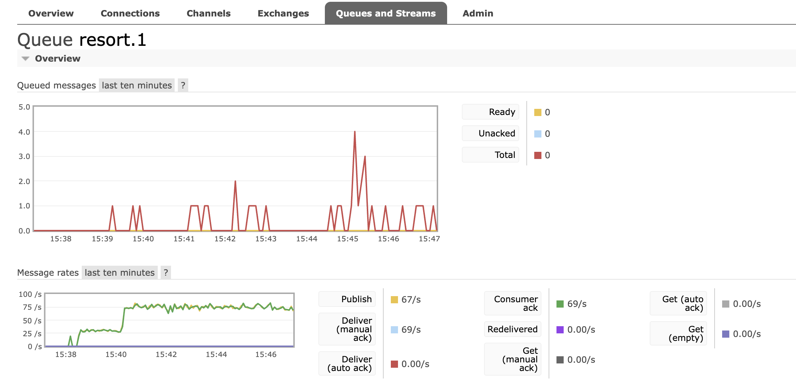

# Assignment 2 — AWS single-ingest 500K, in memory

November 13, 2026 · 15:38:27 PST to 15:50:39 PST

The A2 client and the queue guard ran on the RabbitMQ EC2 instance, sending requests directly to one ingest over its VPC private address. The separate processing EC2 ran the Consumer with `LEADERBOARD_STORAGE=memory`. This measured a single ingest without an AWS ALB hop. The client paced 32,000 warmup swipes at 300/s and 468,000 main swipes at 750/s, using 32 and 128 client threads. The Consumer used 40 workers, prefetch 50, aggregation batches of 50, and ACK batches of 25.

## Client and queue results

| Metric | Result |
|---|---:|
| Successful HTTP 201 / unique client event IDs | 500,000 |
| HTTP failures / logged retryable errors | 0 / 0 |
| HTTP runtime | 732.63 s |
| Overall / main HTTP throughput | 682.48 / 748.02 swipes/s |
| HTTP latency mean / P95 / P99 | 4.29 / 6.16 / 42.50 ms |
| RabbitMQ publish / deliver / ACK, surrounding counter interval | 500,035 / 500,035 / 500,035 |
| Consumer unique swipes / duplicates | 500,000 / 0 |
| New dead letters / broker redeliveries | 0 / 0 |
| Actual ingest backend HTTP 201 POSTs | 500,000 |
| Ready + Unacked peak / average, all 10 resort queues | 23 / 4.72 |
| Largest single-resort Ready + Unacked peak | 8 |
| Consumer lag mean / P95 / P99 / max | 4.78 / 7 / 28 / 781 ms |
| Consumer lag at least 100 ms | 1,152 of 500,000 (0.230%) |

The client, day-scoped ingest access log, and Consumer unique-event delta each accounted for 500,000 swipes. All ten resort queues drained to zero. The broker's cumulative publish, deliver and ACK deltas cover a wider interval and include 35 unattributed messages. These counters have no event IDs or day partition, so attribution uses the client, ingest, and Consumer independently. Queue depth stayed below 1,000 in the 731 one-second samples. Consumer lag is ingest event creation to aggregation start. Its mean and P99 were under 100 ms, while the observed maximum exceeded the target. A paced main phase measures performance near 750 swipes/s. It leaves the maximum sustainable request rate unmeasured.

[Machine-readable summary](summary.json) · [Client output](client-output.txt) · [Queue depth samples](depth-series.csv) · [Broker rates](message-rate-series.csv)

The RabbitMQ console image shows `resort.1` during this run. Its visible peak of four messages reflects the console's sampling window. The full-run one-second sampler provides the depth figures in the table.

The [broker Overview](rabbitmq-console-during-main.png) showed approximately 750 publish/s and 754 ACK/s during the main phase. Its total depth included 84,382 historical dead letters, which were present before the test and excluded from the business-queue figures.

## Live leaderboard evidence

The client received 1,587 distinct updates with 0 invalid payloads and 0 reconnects. The final versions across the ten resorts summed to 1,587, a difference of 0 from the observed update count. In a separate probe day after the 500K, lift 6 added 397 ft for skier 98001. The WebSocket returned that event ID and version 1. Replaying the same event ID left both the vertical total and version unchanged. [Final snapshots](websocket-snapshots.json) · [Swipe and replay evidence](websocket-swipe-proof.json)

## EC2 resources

| Role | Mean host CPU busy | Peak service memory (MiB) | Host RX (MiB) | Host TX (MiB) |
|---|---:|---:|---:|---:|
| ingest-1 | 10.3% | 260.4 | 238.1 | 369.1 |
| consumer | 9.0% | 300.8 | 217.4 | 44.7 |
| rabbitmq | 63.5% | 167.8 | 413.1 | 460.3 |

Samples were taken about every five seconds. Network figures are host totals between the first and last samples inside the HTTP window. The RabbitMQ host totals include the load client.

## Earlier interruption and repeatability

The earlier public-path attempt completed 39,965 HTTP 201s and 39,965 RabbitMQ ACKs (32,000 warmup and 7,965 main). The client logged 78 HTTP connection timeouts, and the local guard stopped new requests when it stopped receiving fresh queue samples. Broker timestamps remained about one second apart. The highest sampled business queue depth was five and dead letters were unchanged, so a queue-depth breach did not trigger the stop. The precise network failure point remains unconfirmed. Moving the client and guard into the VPC kept both the request and monitoring paths independent of the Mac during the rerun.

The original SQLite Consumer was restored after the in-memory test. Its original JAR hash was verified, its processed event count remained 7,507,212, and all ten business queues returned to a steady state. The single-ingest test sent traffic directly, so its records establish neither ALB distribution nor ALB overhead.
