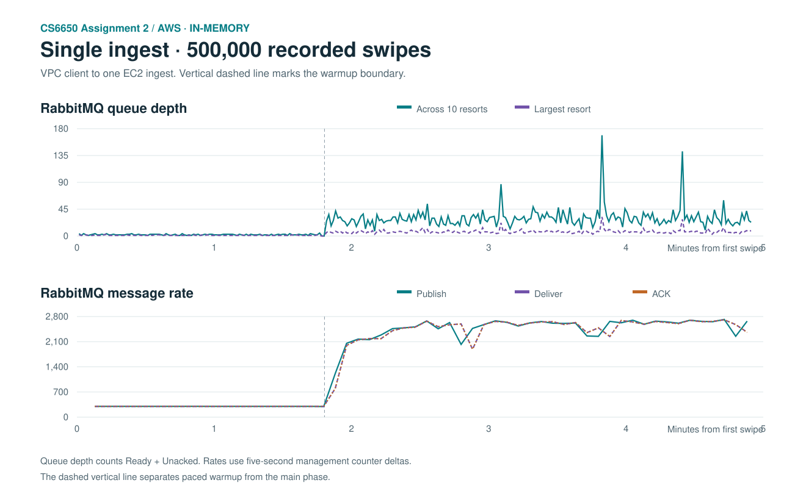
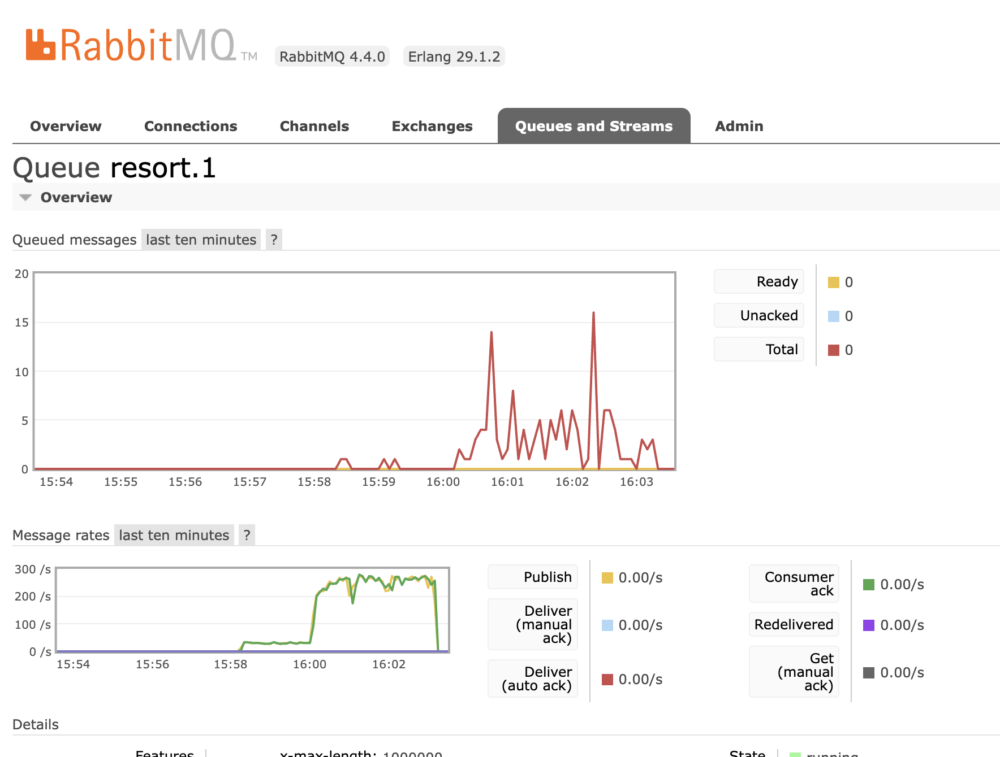

# Assignment 2 — AWS single-ingest unpaced stress test

November 13, 2026 · 15:58:15 PST to 16:03:11 PST

The A2 client and queue guard ran on the RabbitMQ EC2 instance and connected to a single ingest over the VPC private network. Both this run and the [750/s baseline](../aws-single-500k-memory-20261113/README.md) used in-memory aggregation, 300/s warmup for 32,000 swipes, 128 main-phase client threads, and 40 Consumer workers. The main phase used `TARGET_RPS=0`. The queue guard checked the ten resort queues approximately every second.

The 500,000-swipe workload completed. The main phase sustained 2,478.33 requests/s over its measured window, +231.3% versus the paced run.

| Metric | 750/s baseline | Unpaced main phase |
|---|---:|---:|
| Successful HTTP 201 | 500,000 | 500,000 |
| HTTP runtime (s) | 732.63 | 295.83 |
| Main-phase HTTP requests/s | 748.02 | 2,478.33 |
| Overall HTTP requests/s | 682.48 | 1,690.15 |
| HTTP P95 (ms) | 6.16 | 84.45 |
| HTTP P99 (ms) | 42.50 | 115.42 |
| HTTP failures / logged retry triggers | 0 / 0 | 0 / 0 |
| Largest resort queue depth | 8 | 32 |
| Aggregate peak queue depth | 23 | 169 |
| Consumer lag mean (ms) | 4.78 | 33.88 |
| Consumer lag P99 (ms) | 28 | 102 |
| Consumer lag max (ms) | 781 | 687 |
| Swipes with consumer lag ≥ 100 ms | 1,152 | 5,534 |
| Consumer unique swipes | 500,000 | 500,000 |
| New dead letters | 0 | 0 |

5,534 of 500,000 sampled swipes took at least 100 ms to begin aggregation. The maximum observed lag was 687 ms. Queue depth is Ready + Unacked across the ten business queues and excludes the historical dead-letter queue.

The unpaced run recorded 500,000 publishes, 500,000 RabbitMQ deliveries and 500,000 ACKs. The ingest access log recorded 500,000 HTTP 201 POSTs for this test day. Consumer duplicates: 0. Final WebSocket snapshot versions sum to 1,557. The load client recorded 1,557 distinct notifications.

| EC2 role | Mean host CPU busy | Main-phase CPU busy | Mean I/O wait | Peak service memory (MiB) |
|---|---:|---:|---:|---:|
| ingest-1 | 23.0% | 34.9% | 0.05% | 270.2 |
| consumer | 14.1% | 18.3% | 0.02% | 341.8 |
| rabbitmq | 78.5% | 99.3% | 0.02% | 165.8 |

RabbitMQ and the load client shared an EC2 host. The host averaged 99.3% busy CPU during the main phase. This points to shared host CPU as a likely constraint in this setup. Isolating the load client on its own host would help identify the broker’s individual limit. The original SQLite deployment was restored, with its JAR hash and database record count verified.

[Client output](client-output.txt) · [Structured metrics](summary.json) · [Queue series](depth-series.csv) · [Message rate series](message-rate-series.csv) · [Final WebSocket snapshots](websocket-snapshots.json)

## RabbitMQ console evidence

The `resort.1` capture at 16:03:36 PST shows the warmup and unpaced main phase. Publish and consumer ACK curves closely track each other, and the queue reads zero after drain. The visible console peak is about 16 messages. The separate one-second sampler observed a peak of 32 messages for this queue, so the table uses the sampler for its peak.

The 16:03:22 PST RabbitMQ Overview showed aggregate ACK rates around 2,500/s during the main phase. Its 84,382 Ready messages after the test were the existing dead-letter backlog. The benchmark's ten business queues drained, and the dead-letter count stayed unchanged. The 16:05:30 PST CloudWatch screenshot records ALB activity for context. This test's HTTP and WebSocket traffic went directly to one ingest over the VPC, so the screenshot provides no request count or distribution for the test.
