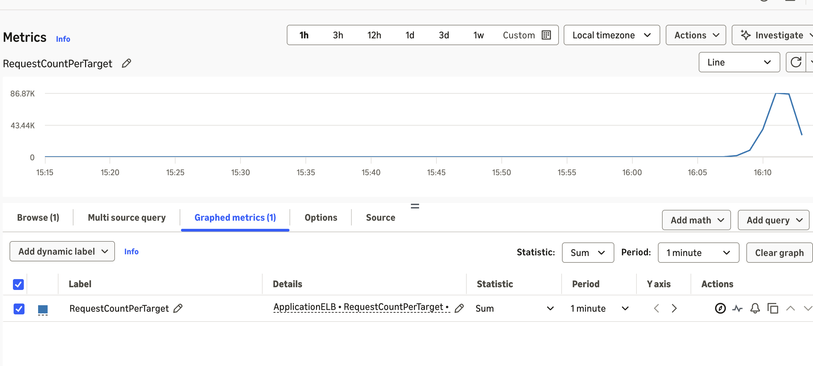
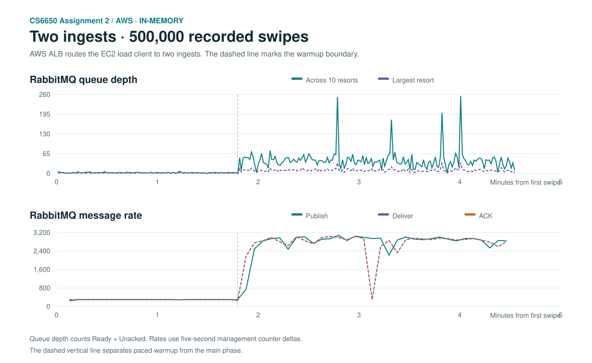
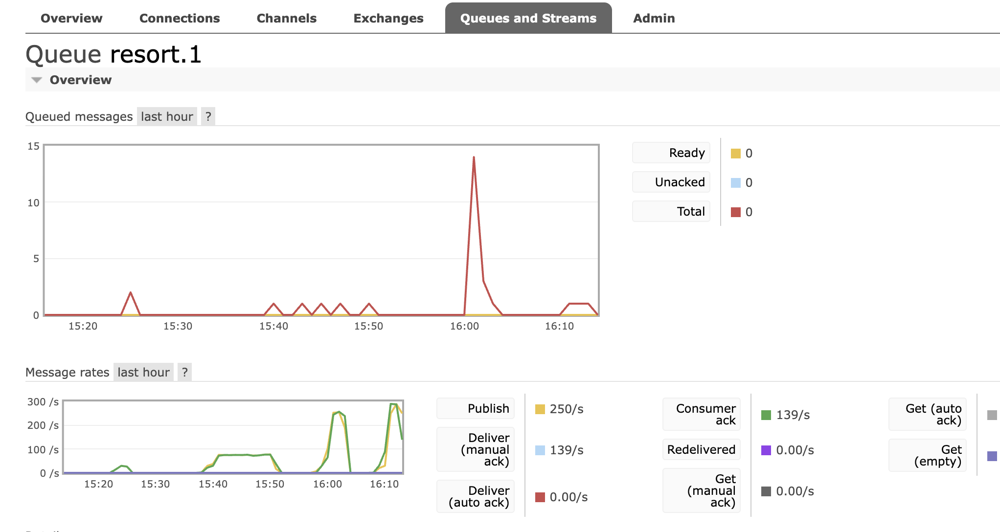

# Assignment 2 — AWS two-ingest unpaced stress test

November 13, 2026 · 16:08:48 PST to 16:13:21 PST

The A2 client and queue guard ran on the RabbitMQ EC2 instance. The AWS Application Load Balancer routed this run to two EC2 ingests. This run and the [single-ingest run](../aws-single-500k-memory-unpaced-20261113/README.md) used in-memory aggregation, 300/s warmup for 32,000 swipes, 128 main-phase client threads, and 40 Consumer workers. Both main phases used `TARGET_RPS=0`. The single-ingest run used a direct VPC connection. The queue guard checked the ten resort queues approximately every second.

The 500,000-swipe workload completed. The main phase sustained 2,824.75 requests/s over its measured window, +14.0% versus the single-ingest direct run.

| Metric | One ingest, direct | Two ingests, ALB |
|---|---:|---:|
| Successful HTTP 201 | 500,000 | 500,000 |
| HTTP runtime (s) | 295.83 | 272.90 |
| Main-phase HTTP requests/s | 2,478.33 | 2,824.75 |
| Overall HTTP requests/s | 1,690.15 | 1,832.15 |
| HTTP P95 (ms) | 84.45 | 68.17 |
| HTTP P99 (ms) | 115.42 | 90.74 |
| HTTP failures / logged retry triggers | 0 / 0 | 0 / 0 |
| Largest resort queue depth | 32 | 35 |
| Aggregate peak queue depth | 169 | 255 |
| Consumer lag mean (ms) | 33.88 | 19.14 |
| Consumer lag P99 (ms) | 102 | 70 |
| Consumer lag max (ms) | 687 | 380 |
| Swipes with consumer lag ≥ 100 ms | 5,534 | 1,015 |
| Consumer unique swipes | 500,000 | 500,000 |
| New dead letters | 0 | 0 |

1,015 of 500,000 sampled swipes took at least 100 ms to begin aggregation. The maximum observed lag was 380 ms. Queue depth is Ready + Unacked across the ten business queues and excludes the historical dead-letter queue.

The unpaced run recorded 500,000 publishes, 500,000 RabbitMQ deliveries and 500,000 ACKs. The combined ingest access logs recorded 500,000 HTTP 201 POSTs for this test day. Consumer duplicates: 0. Final WebSocket snapshot versions sum to 1,636. The load client recorded 1,636 distinct notifications.

## ALB distribution and WebSocket affinity

| Backend | Swipe POST attempts | HTTP 201 | Share of successful POSTs |
|---|---:|---:|---:|
| ingest-1 | 250,000 | 250,000 | 50.00% |
| ingest-2 | 250,000 | 250,000 | 50.00% |
| ingest-3 | 0 | 0 | 0.00% |
| ingest-4 | 0 | 0 | 0.00% |

The WebSocket probe reached both targets on fresh connections. All six reconnections that reused the original AWSALB cookie returned to the original host. The ten final leaderboard snapshots matched between the two ingests, including versions and ordered standings. [ALB affinity probe](alb-affinity.json) · [Second ingest WebSocket snapshots](websocket-snapshots-ingest2.json)

The CloudWatch capture from 16:15:17 PST uses `RequestCountPerTarget`, `Sum`, and a one-minute period. The run's observed HTTP window was 16:08:49–16:13:22 PST. The chart peaks near 86.9K requests per healthy target in a minute. The table uses individual access logs for the exact split. [AWS ALB metrics reference](https://docs.aws.amazon.com/elasticloadbalancing/latest/application/load-balancer-cloudwatch-metrics.html)

| EC2 role | Mean host CPU busy | Main-phase CPU busy | Mean I/O wait | Peak service memory (MiB) |
|---|---:|---:|---:|---:|
| ingest-1 | 14.4% | 20.0% | 0.05% | 250.8 |
| ingest-2 | 15.0% | 21.2% | 0.03% | 237.0 |
| consumer | 15.0% | 18.2% | 0.02% | 381.5 |
| rabbitmq | 76.8% | 99.2% | 0.03% | 182.2 |

RabbitMQ and the load client shared an EC2 host. The host averaged 99.2% busy CPU during the main phase. Host CPU reached about 99% during both unpaced runs, while the processing Consumer host averaged about 18% busy during this run's main phase. This makes CPU on the shared broker/client host a plausible throughput constraint. These samples measure the two processes together. The ALB path and ingest count differ between the two runs. The original SQLite deployment was restored, with its JAR hash and database record count verified.

[Client output](client-output.txt) · [Structured metrics](summary.json) · [Queue series](depth-series.csv) · [Message rate series](message-rate-series.csv) · [Final WebSocket snapshots](websocket-snapshots.json)

## RabbitMQ console evidence

The one-hour console graphs include earlier runs. The rightmost burst covers the two-ingest main phase. The Overview shows 84,382 historical dead letters. The business queue view for `resort.1` shows zero Ready and Unacked at capture. The full-run sampler across the ten business queues provides the queue peaks in the table.

[Broker-wide RabbitMQ Overview](rabbitmq-overview.png)
